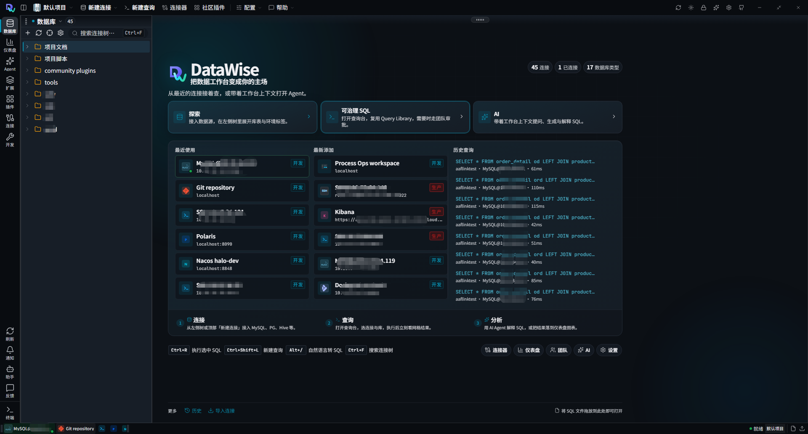
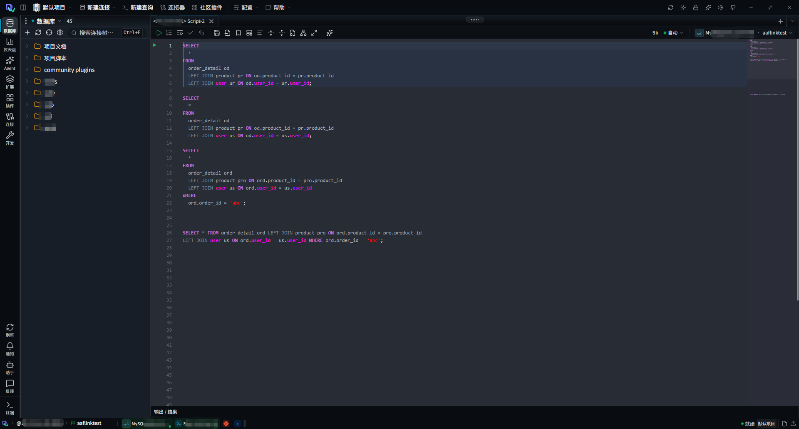
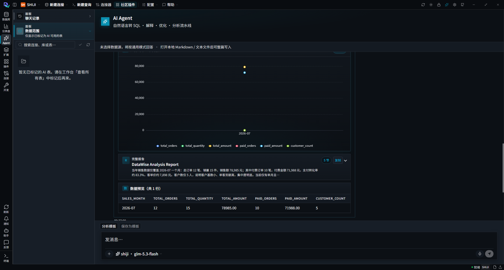
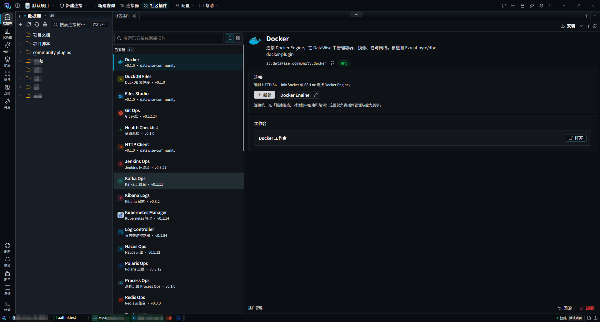

<p align="center">
  
</p>

<h1 align="center">DataWise</h1>

<p align="center">
  <b>AI-native team data workbench</b><br />
  Connect · Query · Govern · Analyze
</p>

<p align="center">
  <a href="./README.zh-CN.md">简体中文</a>
  ·
  <a href="https://github.com/gouyehappy/datawise-pro">GitHub</a>
  ·
  <a href="https://gitee.com/gouyehappy/datawise-pro">Gitee</a>
</p>

<p align="center">
  
  
  
  
</p>

---

## What is DataWise

DataWise is an open-source data workbench for teams: connect databases and ops systems in one place, write governed SQL, analyze with an AI agent, and extend via community plugins. Runs in the **browser** or as a **desktop** app (Windows / macOS / Linux).

### Highlights

| Highlight | What it means |
|-----------|----------------|
| Many engines, one workbench | Relational DBs, domestic CN engines, big data, Redis / Kafka, SSH / K8s share one explorer |
| Governed SQL | Query Library, environment tags, approvals, and team workflows around real scripts |
| AI in context | Table-scoped chat, Text-to-SQL, explain / optimize, charts and analysis reports |
| Plugin extensible | `.dwp` community workbenches; host owns connections, plugins add capabilities |
| Desktop or browser | Same product surface for daily use and local development |

---

## Features

### Home — connections at a glance

Unify databases and ops connections, browse by environment tags, reopen recent work, and jump into query or AI from the home screen.

<p align="center">
  
</p>

### SQL console — write and run where your scripts live

Monaco SQL editor with project scripts, docs, and multi-environment folders side by side.

<p align="center">
  
</p>

### AI Agent — from question to insight

Natural language to SQL, explain and optimize, then run an analysis pipeline — charts, reports, and result previews in the same workbench.

<p align="center">
  
</p>

### Community plugins — ops workbenches in one host

Install `.dwp` plugins (SSH, Git Ops, Docker / K8s, Redis / Kafka, logs, HTTP, and more). The host owns connections; each plugin opens its own workbench.

<p align="center">
  
</p>

---

## Supported connections (sample)

| Kind | Examples |
|------|----------|
| Relational | MySQL · PostgreSQL · Oracle · SQL Server · SQLite · TiDB · OceanBase |
| Domestic CN | Dameng · Kingbase · GaussDB / openGauss · Oscar · HighGo |
| Analytics / big data | ClickHouse · Doris · StarRocks · Hive · Flink · Trino · Presto |
| Middleware & ops | Redis · Kafka · MongoDB · Elasticsearch · SSH · Docker · Kubernetes · Nacos · Jenkins · Git |

Connectors hot-load on demand. Desktop **core** ships MySQL / PostgreSQL / SQLite; install others as needed.

---

## Tech stack

| Layer | Stack |
|-------|--------|
| Frontend | Vue 3 · TypeScript · Vite · Monaco · Pinia |
| Backend | Java 17 · Spring Boot 3 |
| Desktop | JCEF (Windows / macOS / Linux) |
| Ecosystem | Community `.dwp` plugins · MCP · VS Code deep links · Headless CLI |

---

## Quick start

**Requires:** Node 18+ · JDK 17+ · Maven 3.9+

```bash
git clone https://gitee.com/gouyehappy/datawise-pro.git
# or: git clone https://github.com/gouyehappy/datawise-pro.git

cd datawise-pro
npm install
cp config/connections.xml.example config/connections.xml
cp config/users.json.example config/users.json

npm run dev      # local stack
npm run stop
npm run help     # common commands
```

| Command | Meaning |
|---------|---------|
| `npm run dev` | Full local stack |
| `npm run dist` | Desktop installer for the current OS |
| `npm run website` | Marketing site preview |

More scripts: [`scripts/README.md`](./scripts/README.md). Dev ports: frontend `28413` · backend `18421`.

---

## Repository

| Host | URL |
|------|-----|
| Gitee | https://gitee.com/gouyehappy/datawise-pro.git |
| GitHub | https://github.com/gouyehappy/datawise-pro.git |

---

## License

- Main repository: [Apache License 2.0](./LICENSE)
- SQL editor (`sql-editor/`): MIT — see [NOTICE](./NOTICE)
