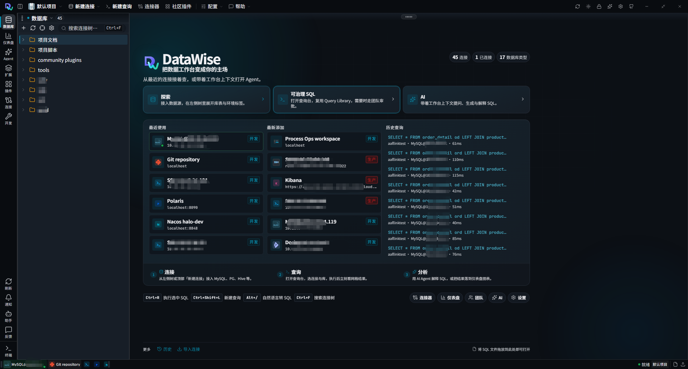
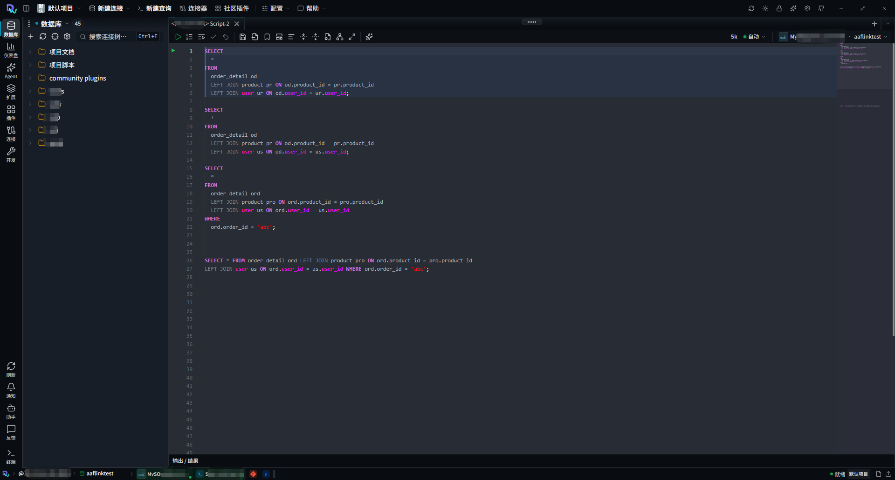
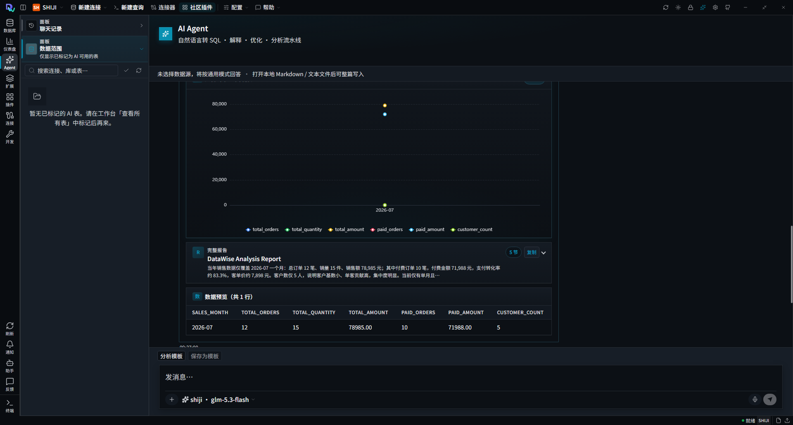
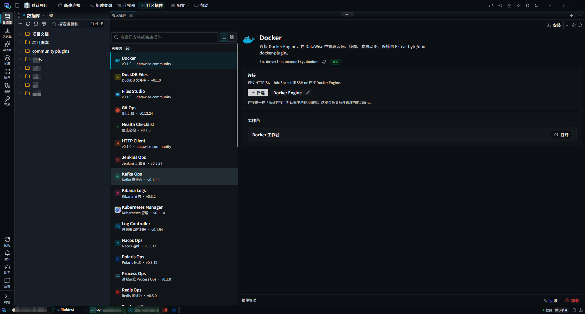

<p align="center">
  
</p>

<h1 align="center">DataWise</h1>

<p align="center">
  <b>AI 驱动的团队数据工作台</b><br />
  连接 · 查询 · 治理 · 分析
</p>

<p align="center">
  <a href="./README.md">English</a>
  ·
  <a href="https://github.com/gouyehappy/datawise-pro">GitHub</a>
  ·
  <a href="https://gitee.com/gouyehappy/datawise-pro">Gitee</a>
</p>

<p align="center">
  
  
  
  
</p>

---

## 项目介绍

DataWise 是面向团队的开源数据工作台：在同一处连接数据库与运维系统，编写可治理的 SQL，用 AI Agent 做分析，再通过社区插件扩展运维能力。支持 **浏览器** 与 **桌面端**（Windows / macOS / Linux）。

### 项目特色

| 特色 | 说明 |
|------|------|
| 多引擎统一 | 关系库、国产库、大数据、Redis / Kafka、SSH / K8s 等共用资源树与首页 |
| 可治理 SQL | Query Library、环境标签、审批与团队协作，围绕真实脚本落地 |
| 上下文 AI | 选表对话、自然语言转 SQL、解释 / 优化、图表与分析报告 |
| 插件扩展 | `.dwp` 社区工作台接入宿主，连接统一管理、能力可插拔 |
| 双端一致 | 浏览器联调与 JCEF 桌面共用同一产品体验 |

---

## 功能概览

### 首页 — 连接一览

统一管理多类数据源与运维连接，按环境标签浏览，回看最近使用，并从首页进入查询或 AI。

<p align="center">
  
</p>

### SQL 控制台 — 脚本与连接同屏

Monaco SQL 编辑器，左侧挂载项目脚本、文档与多环境目录，打开连接即可编写与执行查询。

<p align="center">
  
</p>

### AI Agent — 从问题到洞察

自然语言转 SQL、解释与优化，再跑分析流水线；同一工作台内得到图表、报告与结果预览。

<p align="center">
  
</p>

### 社区插件 — 运维工作台挂进宿主

安装 `.dwp` 插件（SSH、Git Ops、Docker / K8s、Redis / Kafka、日志、HTTP 等）。连接由宿主统一管理，插件打开各自工作台。

<p align="center">
  
</p>

---

## 支持的连接（部分）

| 类型 | 示例 |
|------|------|
| 关系库 | MySQL · PostgreSQL · Oracle · SQL Server · SQLite · TiDB · OceanBase |
| 国产库 | 达梦 · 人大金仓 · GaussDB / openGauss · 神通 · 瀚高 |
| 分析 / 大数据 | ClickHouse · Doris · StarRocks · Hive · Flink · Trino · Presto |
| 中间件与运维 | Redis · Kafka · MongoDB · Elasticsearch · SSH · Docker · Kubernetes · Nacos · Jenkins · Git |

连接器可热加载。桌面默认 **core** 预置 MySQL / PostgreSQL / SQLite，其它引擎按需安装。

---

## 技术栈

| 层 | 技术 |
|----|------|
| 前端 | Vue 3 · TypeScript · Vite · Monaco · Pinia |
| 后端 | Java 17 · Spring Boot 3 |
| 桌面 | JCEF（Windows / macOS / Linux） |
| 生态 | 社区插件 `.dwp` · MCP · VS Code 深链 · Headless CLI |

---

## 快速开始

**环境：** Node 18+ · JDK 17+ · Maven 3.9+

```bash
git clone https://gitee.com/gouyehappy/datawise-pro.git
# 或：git clone https://github.com/gouyehappy/datawise-pro.git

cd datawise-pro
npm install
cp config/connections.xml.example config/connections.xml
cp config/users.json.example config/users.json

npm run dev      # 本地联调
npm run stop
npm run help     # 常用命令
```

| 命令 | 说明 |
|------|------|
| `npm run dev` | 前后端联调 |
| `npm run dist` | 当前系统桌面安装包 |
| `npm run website` | 官网预览 |

更多脚本见 [`scripts/README.md`](./scripts/README.md)。开发端口：前端 `28413` · 后端 `18421`。

---

## 仓库

| 平台 | 地址 |
|------|------|
| Gitee | https://gitee.com/gouyehappy/datawise-pro.git |
| GitHub | https://github.com/gouyehappy/datawise-pro.git |

---

## 发布

桌面产物前缀为 `desktop-v5.0.0-`。发版请执行 `git tag v5.0.0`。

---

## 许可证

- 主仓库：[Apache License 2.0](./LICENSE)
- SQL 编辑器（`sql-editor/`）：MIT — 见 [NOTICE](./NOTICE)
